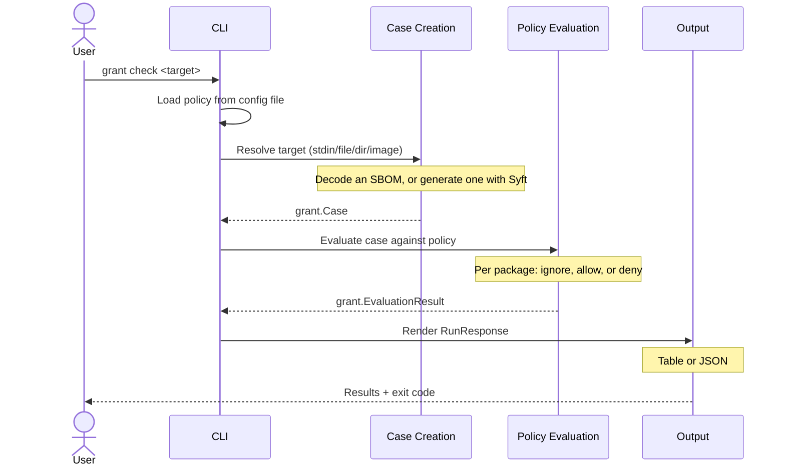
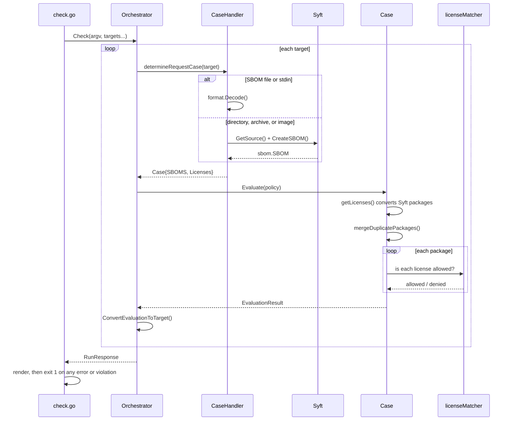

+++
title = "Grant"
description = "Architecture and design of the Grant license compliance tool"
weight = 50
categories = ["architecture"]
tags = ["grant"]
menu_group = "projects"
icon_image = "/images/logos/grant/favicon-48x48.png"
+++


Grant builds on [Syft](): every package and license that Grant evaluates comes from a Syft SBOM, either one you provide or one that Grant generates.

Unlike Syft and Grype, the Grant CLI doesn't use the `clio` application framework described in [Golang CLI Patterns](). It's a plain `cobra` application with its own configuration loading and terminal output.


## Code organization

At a high level, this is the package structure of Grant:

```
./cmd/grant/                // main entrypoint
│   └── cli/
│       ├── command/        // check, list, config, and version commands
│       └── internal/       // config file discovery, table and JSON output, progress display
├── grant/                  // the "core" grant library
└── internal/
    ├── licensepatterns/    // generated file name patterns for license files (LICENSE, COPYING, ...)
    ├── spdxlicense/        // generated SPDX license index, with a risk category per license
    └── stdinbuffer/        // holds stdin bytes so they can be read more than once
```

Grant's core library is the single `grant` package. Its main types work together in a pipeline:

- `CaseHandler` turns one target (an image, SBOM, directory, archive, or file) into a `Case`: the SBOMs for that target plus any license files found next to them.
- `Case.Evaluate` checks the packages in a `Case` against a `Policy` and produces an `EvaluationResult` of allowed, denied, and ignored packages.
- `Orchestrator` runs this for each target and collects the results into a `RunResponse`, which is the JSON document that `grant check -o json` prints.

This design creates a clear flow: **target → case → evaluation → response**:









Shows how one target moves through the core library during `grant check`.







## Target resolution

[`CaseHandler.determineRequestCase`](https://github.com/anchore/grant/blob/main/grant/case.go) decides how to read each target. It checks the target in this order:

| Target                           | Handling                                                                                                                                        |
| -------------------------------- | ----------------------------------------------------------------------------------------------------------------------------------------------- |
| `-`                              | Decode an SBOM from stdin.                                                                                                                      |
| A file with an archive extension | Generate an SBOM with Syft (`.zip`, `.tar`, `.gz`, `.rar`, or `.7z`).                                                                           |
| Any other file                   | Try to decode it as an SBOM in any format Syft supports. If that fails, classify it as a license file.                                          |
| A directory                      | Generate an SBOM with Syft and, at the same time, search the directory for license files. `--disable-file-search` turns off the search.         |
| Anything else                    | Pass it to Syft as a source, so container images and scheme-prefixed targets such as `dir:./project` or `registry:alpine` go through this path. |

A scheme-prefixed target like `dir:./project` isn't a path on disk, so it takes the last branch. Syft still catalogs the directory, but the license file search doesn't run.

When Grant generates an SBOM, it configures Syft for license analysis without network access:

- Remote license lookups for Go and JavaScript packages are off, and so are the Go module cache license search and the Java archive cataloger's network access.
- The `go-module-binary-cataloger` is removed, because it doesn't work well with license analysis.
- The license content coverage threshold is set to 75%.

### License file search

The directory search ([`findLicenseFiles`](https://github.com/anchore/grant/blob/main/grant/case.go)) walks the tree looking for file names that match the generated patterns in `internal/licensepatterns`. It skips common version control, build output, and cache directories, such as `.git`, `vendor`, `dist`, `build`, and `.cache`.

The scan root is treated like a filesystem root: symlinks are resolved inside it and can't escape it, which matches how Syft's directory resolver treats the same target. The search only reads regular files, so it never blocks on a FIFO or device.

Each match is classified with [Google's license classifier](https://github.com/google/licenseclassifier). The `CaseHandler` holds one classifier and guards it with a mutex, because the classifier isn't documented as safe for concurrent use and the directory search runs at the same time as SBOM generation.

Licenses found this way are stored on `Case.Licenses`. `Case.Evaluate` and `Orchestrator.List` currently read packages only from `Case.SBOMS`, so these licenses don't appear in the evaluation results.

## Packages and licenses

Grant converts each Syft package into its own [`grant.Package`](https://github.com/anchore/grant/blob/main/grant/package.go), keeping the name, group (the Maven group ID for Java packages), type, version, licenses, and locations.

A Syft license is usually an SPDX expression, such as `MIT OR Apache-2.0`. Grant keeps it in two forms:

- **Flattened licenses** (`[]License`): each license in the expression, looked up in the SPDX index. Grant reports and counts these.
- **A term tree** (`licenseTerm`): the parsed expression, which keeps the `AND`, `OR`, and `WITH` operators so a policy can apply them.

[`license_expression.go`](https://github.com/anchore/grant/blob/main/grant/license_expression.go) documents the parsing rules in detail. In short:

- `OR` passes when any side passes, and `AND` passes only when every side passes.
- `X WITH E` is a single license. Allowing `X` alone doesn't allow it.
- Separate license declarations on one package must all pass, so they combine like `AND`.
- Grant validates expressions with [go-spdx](https://github.com/github/go-spdx) and parses them with its own parser. If the two disagree, or the expression doesn't parse, Grant falls back to the strict reading: every license must be allowed. A value that isn't a valid expression becomes one non-SPDX license.

An SBOM can list the same package more than once, for example once from a lock file and once from installed metadata. Before evaluation, [`mergeDuplicatePackages`](https://github.com/anchore/grant/blob/main/grant/evaluation.go) merges entries with the same group, name, version, and type into one package, and combines their licenses and locations. `grant list` does the same merge, so each real package appears once.

## Policy evaluation

A [`Policy`](https://github.com/anchore/grant/blob/main/grant/policy.go) has four fields, which map to the keys in a `.grant.yaml` file:

| Field                 | YAML key                | Effect                                                                 |
| --------------------- | ----------------------- | ---------------------------------------------------------------------- |
| `Allow`               | `allow`                 | License patterns that are permitted. Everything else is denied.        |
| `IgnorePackages`      | `ignore-packages`       | Package name patterns to skip entirely.                                |
| `RequireLicense`      | `require-license`       | Deny packages with no licenses.                                        |
| `RequireKnownLicense` | `require-known-license` | Deny licenses that aren't SPDX IDs or that are unparsable expressions. |

`Case.Evaluate` decides each package in this order:

1. If the package name, or its group-qualified name, matches `ignore-packages`, the package is **ignored**.
2. If the package has no licenses, it's **denied** when `require-license` is set and **allowed** otherwise.
3. Otherwise, each license declaration is checked against `allow`. The package is **allowed** only if every declaration passes and no license is denied.

A target is `noncompliant` when any package is denied, and `compliant` otherwise.

### License matching

Allow and ignore patterns are globs with [`path.Match`](https://pkg.go.dev/path#Match) syntax on every operating system, so results don't depend on the host. Grant also accepts the regex-style shorthands `.*` and `.+`, and converts them to `*`. An `ignore-packages` pattern ending in `/*` matches packages at any depth below that prefix.

On top of literal and glob matches, the `licenseMatcher` applies SPDX version ranges. A declared `GPL-2.0-or-later` (or `GPL-2.0+`) is allowed by `allow: [GPL-3.0-only]`, because that range includes GPL-3.0. Ranges only apply to declared licenses: an allow entry such as `GPL-2.0-or-later` matches literally and never admits `GPL-3.0-only`. The comments on `licenseMatcher` in `policy.go` list the edge cases, each pinned by a test in `license_expression_test.go`.

## Output and exit codes

[`response.go`](https://github.com/anchore/grant/blob/main/grant/response.go) defines the `RunResponse` document. It records the command's `argv`, the policy that was applied, and one result per target, with a status, summary counts, and a decision for each package.

| Status         | Meaning                                              |
| -------------- | ---------------------------------------------------- |
| `compliant`    | No packages were denied.                             |
| `noncompliant` | At least one package was denied.                     |
| `error`        | Grant couldn't read or evaluate the target.          |
| `unevaluated`  | `grant list` output, which doesn't apply the policy. |

`grant check` exits with code 1 when any target has the `error` status, or when any target is `noncompliant` and `--dry-run` isn't set. `grant list` exits with code 0 unless processing fails.

Both commands can also read a previous `RunResponse`. When the target is `-` or a `.json` file containing Grant JSON output, the CLI renders it again without re-scanning, and `grant list` applies its license filters to it. Stdin can only be read once, so when stdin turns out not to be Grant JSON, the CLI stores the bytes in `internal/stdinbuffer` for the SBOM decoder to read.

## CLI and core API

The CLI (in `cmd/grant/`) and the core library (in `grant/`) are separate layers. The library takes a `Policy` and a `CaseConfig`, and has no knowledge of config files, flags, or terminal output. The CLI handles these:

- **Config discovery**: with no `--config` flag, the CLI looks for `grant.yaml`, `grant.yml`, `.grant.yaml`, or `.grant.yml` in the current directory, then in the XDG config directories, then in your home directory. If it finds no file, it uses a default policy that allows no licenses and requires every package to have one.
- **Output**: table or JSON output, a summary view, and the `--unlicensed` filter.
- **License risk**: `grant list --group-by risk` groups licenses by the risk category stored in `internal/spdxlicense`, such as permissive or strong copyleft.

## Generated code

Two internal packages are generated from the SPDX license list. Regenerate them with `make generate` when the list changes:

- `internal/spdxlicense/license_index.go` (`make generate-spdx-licenses`): the SPDX license index, used to look up license IDs and their metadata.
- `internal/licensepatterns/patterns.go` (`make generate-license-patterns`): the license file name patterns used by the directory search.

See the [Grant contributing guide]() for development setup and testing.
